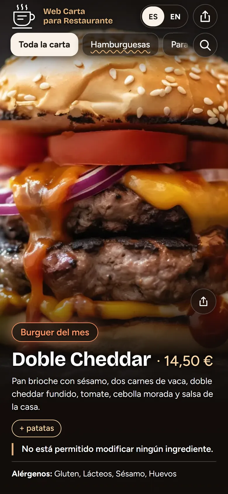
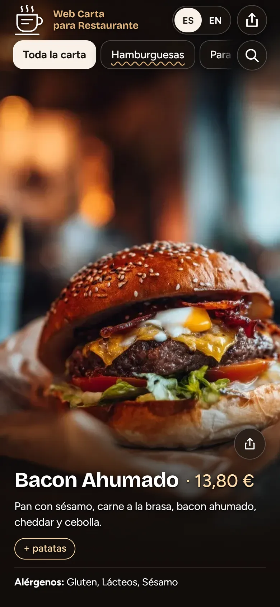
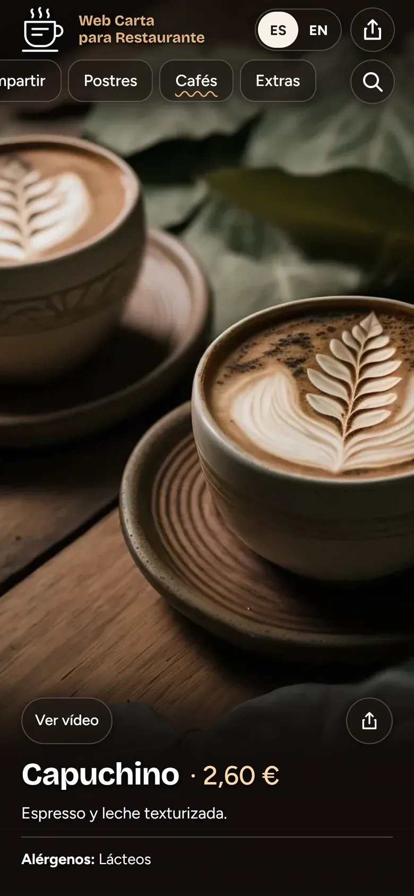
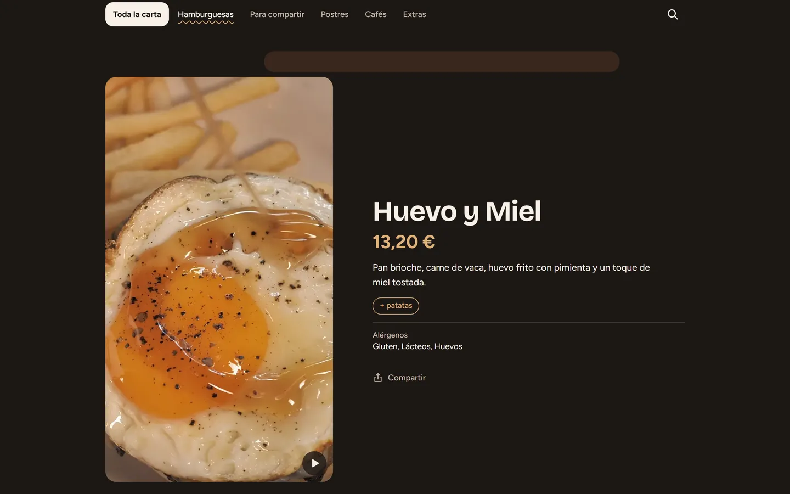
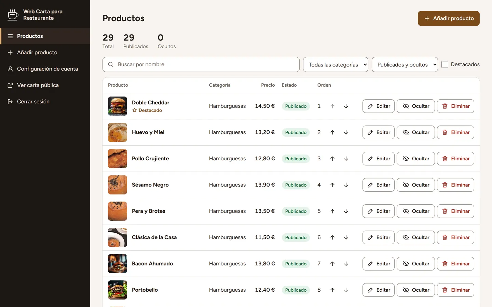

# Web Carta para Restaurante / Restaurant Web Menu

Carta digital en español e inglés, con **panel privado** para gestionarla sin tocar código. Es una web de **muestra**: platos, precios, alérgenos y contacto son ficticios, y lleva `noindex`. Proyecto de uso libre (licencia MIT) creado por Enrique Sojo · [www.enriquesojo.es](https://www.enriquesojo.es).

<p>
  
  
  
</p>
<p>
  
</p>
<p>
  
</p>

## Qué incluye
- **Carta pública**: un plato por pantalla en el móvil, vídeos que se reproducen solos al llegar a ellos, buscador, español e inglés, alérgenos y compartir.
- **Panel privado** en `/superuser`: añadir, editar, ordenar, ocultar y eliminar productos; subir fotos y vídeos; cambiar la contraseña y hacer copias.
- **Servidor** Node.js + Express + SQLite, con sesiones seguras, protección CSRF y límite de intentos.

## Usarla en este ordenador
Doble clic en `INICIAR-CARTA.bat`.

- Carta: http://localhost:4188
- Panel: http://localhost:4188/superuser

Antes, copia `.env.example` como `.env` y escribe una contraseña en `ADMIN_PASSWORD` (ver Instalación). En producción el servidor no arranca con una contraseña débil.

## Documentación
- [Manual del panel](docs/MANUAL-PANEL.md), para el propietario
- [Documentación técnica](docs/TECNICO.md): decisiones, producción, copias, recuperación de contraseña, pruebas y limitaciones
- [Licencias](docs/LICENCIAS.md) de fotos, vídeos y tipografías. El código es MIT ([LICENSE](LICENSE)); las fotos y los vídeos conservan sus propias licencias.

## Instalación
Node.js 22.18 o superior.

```powershell
npm install
```

```powershell
Copy-Item .env.example .env
```

Escribe `ADMIN_PASSWORD` en `.env`. Después:

```powershell
npm run build
```

```powershell
npm run local
```

El primer arranque crea `data/` con la carta original. Los siguientes no la modifican.

## Órdenes

| Orden | Para qué sirve |
|---|---|
| `npm run dev` | Desarrollar, con recarga en vivo |
| `npm run build` | Compilar |
| `npm run local` | Servir lo compilado, solo en este ordenador |
| `npm start` | Producción |
| `npm test` | Compilar y ejecutar las pruebas, en una carpeta temporal |
| `npm run clave` | Cambiar la contraseña desde el servidor |
| `npm run copia` | Copia completa: base de datos y multimedia |
| `npm run restaurar -- <carpeta>` | Volver a una copia |
| `npm run iconos` | Regenerar iconos desde el logotipo (necesita `originales/`) |

## Adaptarla a otra marca

| Qué | Dónde |
|---|---|
| Productos, precios, fotos y vídeos | Panel |
| Nombre, teléfono, dirección y redes | `src/data/restaurante.json` |
| Logotipo | `public/brand/logotipo.svg`, y después `npm run iconos` |
| Colores y tipografías | Principio de `src/styles/main.css` |
| Textos de la interfaz, legales y alérgenos | `src/data/` |
| Carta de partida de una instalación nueva | `seed/` |
| Aviso de muestra y `noindex` | Texto `sample` en `src/data/textos.json`; etiqueta `robots` en `index.html` |
